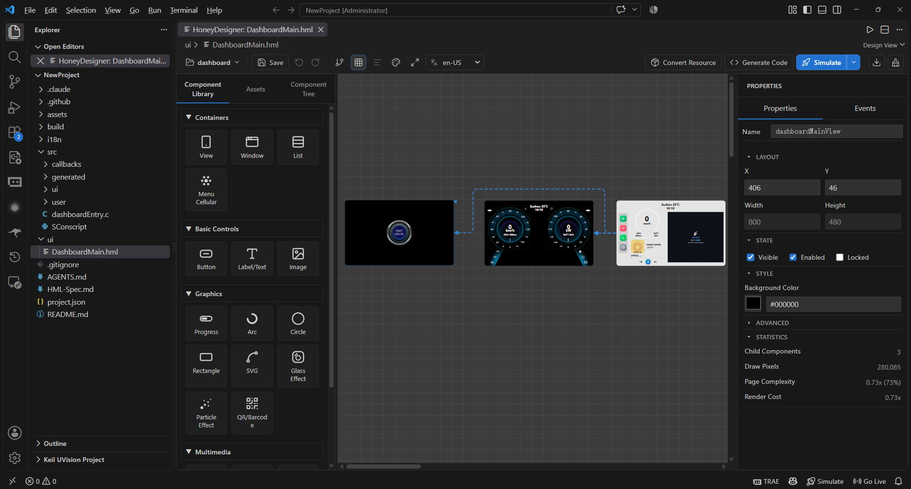
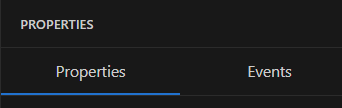
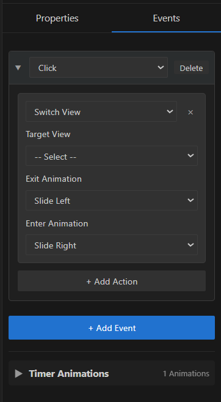

设计器使用
==========

HoneyDesigner 提供可视化画布、组件与资源面板、属性面板和视图导航图。

界面布局
---------

设计器由四个主要区域组成：

   设计器界面

1. **工具栏** （顶部）

   * 保存、撤销、重做。
   * 对齐、分布、辅助线、画布背景、适配内容。
   * 视图关系图、预览语言、工程配置选择。
   * 生成代码、编译仿真、调试、停止、UART 下载、清理。

2. **组件与资源面板** （左侧）

   * **组件库**：可用组件及其分类。
   * **资源**：管理图片、字体、视频、模型等素材。
   * **组件树**：当前页面的组件层级。

3. **画布** （中央）

   * 拖放组件、选择、移动、缩放、对齐、框选。
   * 鼠标滚轮围绕指针缩放。
   * 支持智能辅助线和网格吸附。

4. **属性面板** （右侧）

   * **属性**：编辑所选组件的属性。
   * **事件**：配置事件与动作。

工具栏
-------

常用操作
~~~~~~~~~

* **保存**：``Ctrl+S``。
* **撤销/重做**：``Ctrl+Z`` / ``Ctrl+Y`` 或 ``Ctrl+Shift+Z``。
* **生成代码**：``Ctrl+G``。
* **编译仿真**：启动资源转换、代码生成、编译和仿真流程。
* **调试仿真**：以 GDB 调试方式运行。
* **无代码生成运行**：跳过代码生成，直接编译/运行已有代码。
* **停止**：停止当前仿真。
* **UART 下载**：把 romfs 下载到开发板。
* **清理**：删除构建产物。

视图工具
~~~~~~~~~

* **显示/隐藏辅助线**。
* **对齐和分布**：至少选中两个组件后可用。
* **画布背景色**。
* **适配全部内容**：把画布内容缩放到可视区域，实际缩放范围约为 10% 到 500%。
* **视图关系图**：查看和编辑页面跳转关系。
* **预览语言**：切换画布使用的项目语言，配置方法见 :ref:`多语言预览 <designer-localization-preview-cn>`。
* **工程配置**：在 ``config/*.json`` 之间切换项目配置。

.. _designer-localization-preview-cn:

多语言预览
~~~~~~~~~~~

工具栏上的语言下拉框只负责切换预览语言。要显示不同语言的文本，需要先完成以下配置：

1. 打开工具栏最左侧的工程菜单，选择 **多语言管理**，添加项目需要支持的语言。默认语言不能被删除。
2. 在 **多语言管理** 中新建词条，或编辑已有的 ``i18n/strings.json``。
3. 在属性面板中为文本组件设置 ``i18nKey``，让它引用项目词条。没有设置 ``i18nKey`` 的组件仍使用自身的 ``text``。
4. 使用工具栏的语言下拉框切换预览语言，画布会立即显示对应语言的文本。

预览语言会写入 ``i18n/strings.json`` 的 ``activeLocale``，并随项目保存。生成代码时，插件会把当前预览语言对应的文本写入生成的 C 代码；切换语言后立即生成，也会使用新语言。

如果某个词条缺少当前语言的翻译，画布会依次回退到默认语言文本、组件 ``text``，最后使用组件名称。可以在 **多语言管理** 中使用 **缺少翻译** 筛选集中检查这些词条。

工程配置
~~~~~~~~~

项目可以在 ``config/`` 目录下保存多套 ``project.json`` 配置：

* 工具栏的工程配置下拉框可以切换。
* 切换后插件会更新项目配置并重新生成代码。
* 适合在同一项目中维护不同分辨率、像素模式或目标引擎配置。

AI 协作资产
^^^^^^^^^^^

新建项目时可以启用 AI 协作资产。启用后项目会包含：

* ``.claude/skills/honeygui-designer/``：HML 设计技能和规范。
* ``AGENTS.md``：AI 代理入口。

不需要时可以在 ``project.json`` 中设置 ``"aiAssets": false``，插件会清理已分发的资产。

视图导航图
~~~~~~~~~~~

工具栏的视图关系按钮可以打开导航图，查看页面之间的 ``switchView`` 跳转：

* 节点表示视图。
* 连线表示跳转。
* 可以新建、编辑或删除跳转。
* 布局保存在项目 ``.honeygui/nav-layout.json``。

导航图适合检查悬空跳转和复杂页面关系。

组件与资源面板
---------------

组件库
~~~~~~~

组件分类
^^^^^^^^^

**容器**

.. list-table::
   :header-rows: 1
   :widths: 30 70

   * - 组件
     - 用途
   * - ``hg_view``
     - 页面/视图容器，用于组织一屏界面；不能嵌套 ``hg_view``。
   * - ``hg_window``
     - 窗口容器，用于弹窗、浮层或独立窗口。
   * - ``hg_list``
     - 可滚动列表容器，用于管理一组列表项。
   * - ``hg_menu_cellular``
     - 蜂窝/宫格菜单容器，用于图标网格导航。

**基础控件**

.. list-table::
   :header-rows: 1
   :widths: 30 70

   * - 组件
     - 用途
   * - ``hg_button``
     - 按钮，支持文本、图片、点击回调和开关状态。
   * - ``hg_label``
     - 文本标签，支持字体、颜色、渐变、多行和滚动文本。
   * - ``hg_image``
     - 图片控件，显示图片并支持裁剪、缩放等显示设置。

**输入控件（仅 LVGL）**

.. list-table::
   :header-rows: 1
   :widths: 30 70

   * - 组件
     - 用途
   * - ``hg_input``
     - 文本输入框，接收用户输入。
   * - ``hg_checkbox``
     - 复选框，用于多项选择。
   * - ``hg_radio``
     - 单选按钮，用于一组选项中的互斥选择。
   * - ``hg_switch``
     - 开关控件，用于在开/关两种状态间切换。
   * - ``hg_slider``
     - 滑块控件，用于连续调节数值。
   * - ``hg_progressbar``
     - 进度条，用于显示任务进度。

**图形**

.. list-table::
   :header-rows: 1
   :widths: 30 70

   * - 组件
     - 用途
   * - ``hg_progress``
     - 多模式进度组件，支持线性、分段、弧形、仪表盘和加载动画。
   * - ``hg_arc``
     - 圆弧控件，用于绘制弧形、环形进度或仪表盘元素。
   * - ``hg_circle``
     - 圆形控件，用于绘制圆、圆环及发光/阴影效果。
   * - ``hg_rect``
     - 矩形控件，用于绘制矩形、圆角、边框、发光和阴影。
   * - ``hg_svg``
     - SVG 矢量图控件，用于显示可缩放的矢量图形。
   * - ``hg_glass``
     - 玻璃/模糊效果控件，按形状路径对背景做折射或模糊。
   * - ``hg_particle``
     - 粒子效果控件，用于烟花、雪花等粒子动画。
   * - ``hg_qbcode``
     - 二维码/条形码控件，根据内容生成 QR 码或条码。

**多媒体**

.. list-table::
   :header-rows: 1
   :widths: 30 70

   * - 组件
     - 用途
   * - ``hg_video``
     - 视频播放控件，支持裁剪、缩放和自动播放。
   * - ``hg_streaming``
     - 流媒体控件，按帧接收 JPEG、RAW、H.264 等数据并实时显示。
   * - ``hg_gif``
     - GIF 动图控件，用于播放 GIF 动画。
   * - ``hg_3d``
     - 3D 模型控件，用于加载和显示 OBJ/GLTF 等模型。
   * - ``hg_lottie``
     - Lottie 动画控件，用于播放 JSON 格式的矢量动画。

引擎支持：

* **HoneyGUI**：不支持输入类控件（``hg_input``、``hg_checkbox``、``hg_radio``、``hg_switch``、``hg_slider``、``hg_progressbar``）。
* **LVGL**：不支持 ``hg_menu_cellular``、``hg_progress``、``hg_glass``、``hg_particle``、``hg_video``、``hg_streaming`` 和 ``hg_3d``。
* 组件库会按当前项目的 ``targetEngine`` 自动隐藏不支持的组件。

以下控件不直接出现在主组件库中：

* ``hg_time_label``：时间标签，按指定格式显示当前时间。
* ``hg_timer_label``：计时标签，用于秒表或倒计时显示。
* ``hg_list_item``：列表项容器，由 ``hg_list`` 管理，表示列表中的单个条目。

添加组件
^^^^^^^^^

1. 从组件库拖动控件到画布。
2. 图片等资源可以从 **资源** 面板直接拖到画布，生成对应的图片、视频等控件。

控件放到画布后，拖动时会自动吸附到父容器或同级组件的边缘、中心，并显示智能辅助线。工具栏的智能辅助线按钮可以显示或隐藏这些辅助线。

资源
~~~~~

资源面板用于管理项目中的图片、字体、视频、3D 模型等资源。可以：

* 导入、重命名和删除资源。
* 配置图片、字体、视频等资源的转换参数。
* 把资源直接拖到画布，生成对应的图片、视频等控件。

组件树
~~~~~~~

左侧 **组件树** 区域显示当前页面的层级结构：

.. code-block:: text

   view_home (hg_view)
   ├── lbl_title (hg_label)
   ├── img_logo (hg_image)
   └── btn_next (hg_button)

操作：

* 点击节点选中组件，画布同步高亮。
* 拖动节点改变父子关系或顺序。
* 右键打开上下文菜单。
* 点击箭头展开/折叠。

.. note::
   ``hg_view`` 不能嵌套 ``hg_view``。页面切换请使用事件动作 ``switchView``。

画布
-----

选择
~~~~~

* 单击组件选中。
* 按住 ``Ctrl`` 点击可多选。
* 在空白处拖出矩形框可框选。
* 按 ``Esc`` 取消选择。

移动和调整尺寸
~~~~~~~~~~~~~~~

* 拖动组件移动。
* 拖动八个控制点调整尺寸。
* 方向键移动 1 像素，``Shift`` + 方向键移动 10 像素。
* 多选时所有选中组件一起移动。

画布缩放和平移
~~~~~~~~~~~~~~~

* 鼠标滚轮围绕指针缩放。
* ``Space`` + 拖动平移画布。
* 工具栏“适配全部内容”自动缩放到可视区域。

对齐和分布
~~~~~~~~~~~

选中两个或更多组件后，可以：

* 左对齐、右对齐、顶部对齐、底部对齐。
* 水平居中、垂直居中。
* 水平分布、垂直分布。

快捷键：

* ``Ctrl+Shift+L/R/T/B/H``：左/右/上/下/水平居中对齐。
* ``Ctrl+Shift+D``：水平分布。
* ``Ctrl+Alt+D``：垂直分布。

右键菜单
~~~~~~~~~

画布组件的右键菜单包含：

* **跳转到槽函数**：跳转到对应的回调函数。
* **复制给 AI**：复制组件上下文给 AI 代理。
* **置于顶层 / 置于底层**：调整组件层级。
* **上移一层 / 下移一层**：逐层调整组件层级。
* **锁定 / 解锁**：锁定或解锁组件。
* **删除**：删除组件。

复制、粘贴、剪切使用快捷键或组件树操作；重命名在属性面板中修改 ID/名称。

属性面板
---------

属性面板分为基础属性和事件两个部分。

基础属性
~~~~~~~~~

   属性面板

属性面板按分类组织，常用分组包括：

* **基本信息**：名称、ID、父容器。
* **布局**：X、Y、宽度、高度。
* **状态**：可见、启用、锁定、显示溢出。
* **内容**：文本、图片路径、数值、占位符等。
* **字体**：字体文件、字号、字体类型、渲染模式。
* **样式**：颜色、背景、边框、圆角、渐变、发光、阴影。
* **变换**：旋转、缩放、透明度、变换中心。
* **渲染**：混合模式、裁剪、高质量等。
* **交互**：按钮状态、可移动、点击等。
* **行为**：定时器、动画、特殊行为。
* **高级**：入口页面、常驻内存、切换函数等。

特定属性
^^^^^^^^^

不同组件的特定属性不同，以下列出常用组件的关键属性；完整分组以属性面板为准。

**hg_button**

* ``text``：按钮文字
* ``color``：文字颜色
* ``toggleMode``：是否为双态按钮
* ``imageOn`` / ``imageOff``：开启/关闭状态图片路径
* ``clickCallback``：点击回调函数

**hg_label**

* ``text``：文本内容，支持多行
* ``fontSize`` / ``fontFile``：字号和字体文件
* ``color``：字体颜色
* ``hAlign`` / ``vAlign``：水平/垂直对齐（``LEFT``、``CENTER``、``RIGHT``；``TOP``、``MID``、``BOTTOM``）
* ``letterSpacing`` / ``lineSpacing``：字间距和行间距
* ``wordWrap`` / ``wordBreak``：自动换行和断词
* ``i18nKey``：引用项目多语言词条

**hg_image**

* ``src``：图片文件路径
* ``visible``：是否显示

**hg_arc**

* ``radius``：半径
* ``startAngle`` / ``endAngle``：起止角度
* ``strokeWidth``：线宽
* ``color``：颜色
* ``opacity``：透明度（0-255）
* ``useGradient``：是否启用渐变

**hg_circle**

* ``radius``：半径
* ``fillColor`` / ``strokeColor``：填充色和描边色
* ``strokeWidth``：描边宽度
* ``opacity``：透明度（0-255）
* ``useGradient`` / ``gradientType``：渐变开关和类型
* ``glowEnabled`` / ``shadowEnabled``：发光和阴影开关

**hg_rect**

* ``borderRadius``：圆角半径
* ``fillColor`` / ``strokeColor``：填充色和描边色
* ``strokeWidth``：描边宽度
* ``opacity``：透明度（0-255）
* ``useGradient`` / ``gradientDirection``：渐变开关和方向
* ``glowEnabled`` / ``shadowEnabled``：发光和阴影开关
* ``buttonMode``：按键效果（``none``、``dual-state``、``opacity``）

其他组件（输入框、开关、滑块、列表、视频、3D、Lottie 等）也有各自属性。发光和阴影仅 HoneyGUI 支持。

事件
~~~~~

   事件面板

事件面板用于配置：

* 事件类型。
* 动作类型和参数。
* 按键名、消息名、函数名。
* 定时器控制目标。

详见 :doc:`事件系统 <event_system>`。

键盘快捷键
-----------

编辑：

* ``Ctrl+S``：保存。
* ``Ctrl+Z``：撤销。
* ``Ctrl+Y`` 或 ``Ctrl+Shift+Z``：重做。
* ``Ctrl+C`` / ``Ctrl+X`` / ``Ctrl+V``：复制/剪切/粘贴。
* ``Ctrl+D``：复制组件。
* ``Delete``：删除。

选择：

* ``Ctrl`` + 点击：多选。
* ``Esc``：取消选择。

精确定位：

* 方向键：移动 1 像素。
* ``Shift`` + 方向键：移动 10 像素。

其他：

* ``Ctrl+G``：生成代码。
* ``F5``：预览。
* ``Space`` + 拖动：平移画布。

最佳实践
---------

* 使用有意义的 ID，如 ``btn_login``，而不是 ``button1``。
* 不要嵌套 ``hg_view``。
* 使用 ``hg_view`` 组织页面，用 ``hg_window`` 组织弹窗。
* 复杂界面拆分为多个 HML 文件。
* 组件 ID 在项目内保持唯一。
* 事件逻辑放在回调保护区或 ``src/user``。
* 定期保存并提交 HML 文件。

下一步
-------

* 了解 :doc:`HML 文件格式 <hml_format>` 进行手动编辑
* 掌握 :doc:`事件系统 <event_system>` 实现交互
* 学习 :doc:`代码生成机制 <code_generation>` 理解代码结构
