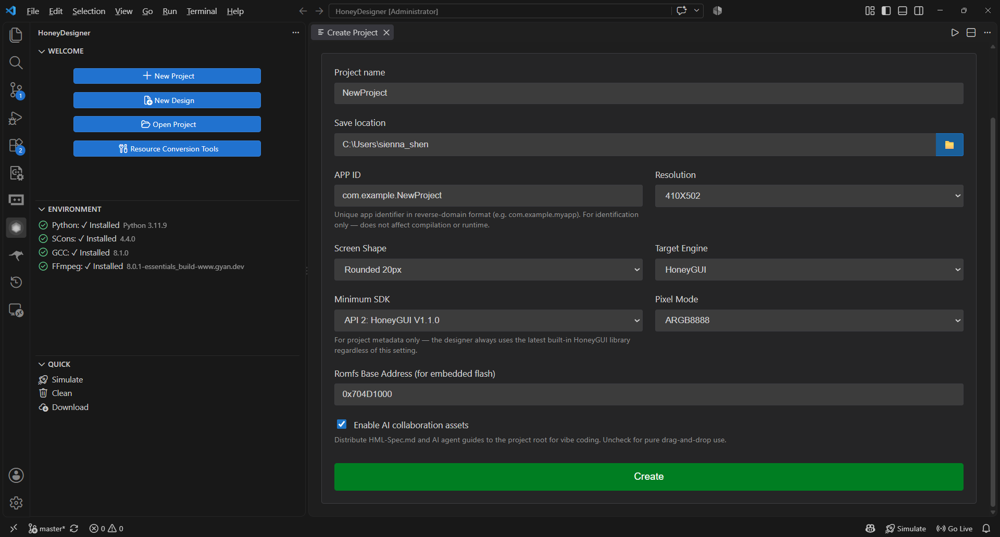
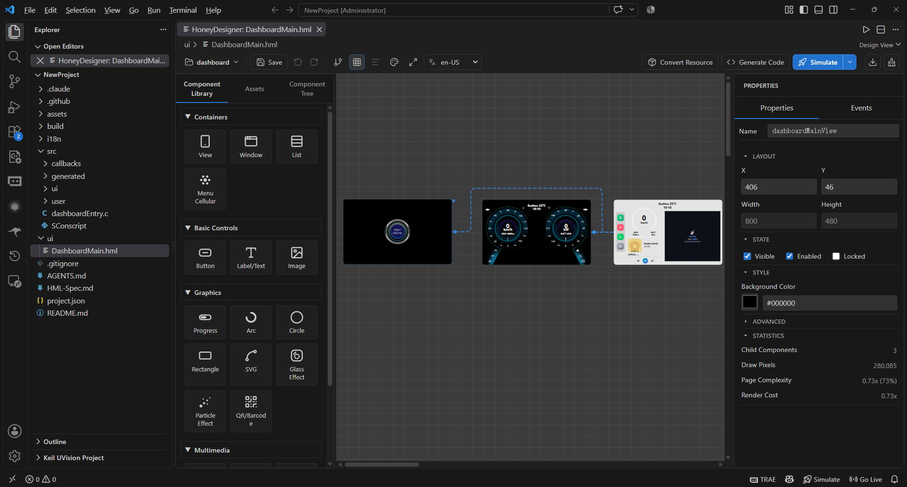
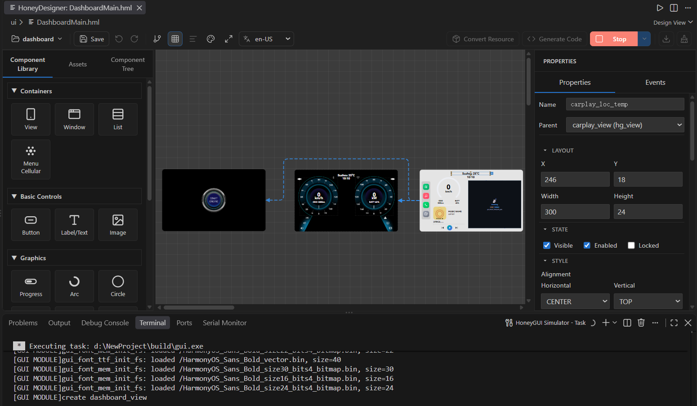

快速开始
========

本章介绍如何安装 HoneyDesigner、创建项目并完成第一次代码生成和仿真。

环境要求
---------

必需软件：

* **VSCode**：1.80.0 或更高版本。
* **Python**：3.9.7 或更高，用于 romfs 打包和构建辅助脚本。
* **SCons**：4.4.0，通过 ``pip install scons==4.4.0`` 安装。
* **GCC/MinGW**：Windows 推荐 MinGW-w64 8.1.0 或更高；Linux/WSL 使用系统 GCC。
* **SDL2**：Linux/WSL 需要 ``sudo apt-get install libsdl2-dev``。
* **Git**：从模板创建项目时需要。

可选软件：

* **FFmpeg**：视频转换需要；未安装时视频资源会被跳过。
* **CMake**：LVGL 项目仿真需要。

.. note::
   当前版本不再依赖 ``kconfiglib``，也不需要手动运行 ``menuconfig``。构建脚本会自动生成固定配置。

安装插件
---------

方法一：从 VSCode 市场安装
~~~~~~~~~~~~~~~~~~~~~~~~~~~

1. 打开 VSCode。
2. 打开扩展面板，搜索 ``HoneyDesigner``。
3. 点击 :guilabel:`安装`。

方法二：从 VSIX 安装
~~~~~~~~~~~~~~~~~~~~~

1. 从 Marketplace 插件页面的 :guilabel:`Download Extension` 下载 ``.vsix`` 文件，或使用提供的离线安装包。
2. 打开扩展面板右上角的 ``...`` 菜单。
3. 选择 :guilabel:`从 VSIX 安装...`。
4. 选择下载好的 ``.vsix`` 文件。

环境检查
---------

1. 点击活动栏的 HoneyDesigner 图标。
2. 在 **环境** 视图中查看 Python、SCons、GCC、SDL2、FFmpeg 状态。
3. 点击刷新按钮，或在命令面板执行 ``刷新环境检查``。
4. 缺失项可以直接使用视图中的安装入口，或按提示安装。

创建第一个项目
---------------

1. 在 HoneyDesigner 侧边栏点击 :guilabel:`新建项目`。
2. 选择 :guilabel:`创建空白项目` 或 :guilabel:`从模板创建项目`。
3. 填写项目名称、保存位置、APP ID 等信息。

空项目可配置：

* 分辨率
* 屏幕形状（矩形、圆形、圆角）
* 目标引擎（HoneyGUI 或 LVGL）
* 最低 SDK
* 像素模式
* Romfs 基地址
* 是否启用 AI 协作资产

可用模板：

* Smart Watch
* Car Dashboard
* Chat Bot
* Rotary Knob
* Settings
* E-Badge

.. note::
   模板通过 Git 仓库克隆，首次创建需要网络和 ``git``。空项目不需要网络。

   创建项目

项目结构
~~~~~~~~~

.. code-block:: text

   my-project/
   ├── project.json              # 项目配置
   ├── ui/                       # HML 设计文件
   │   └── MyProjectMain.hml
   ├── src/                      # 生成的 C 代码
   │   ├── MyProjectEntry.c      # 项目入口（含保护区）
   │   ├── SConscript            # HoneyGUI 构建脚本
   │   ├── ui/                   # UI 代码，每次生成覆盖
   │   ├── callbacks/            # 回调代码，保留保护区
   │   ├── user/                 # 用户代码，只生成一次
   │   └── lvgl/                 # LVGL 项目的生成目录
   ├── assets/                   # 图片、字体、视频、模型等资源
   ├── i18n/strings.json         # 可选，项目多语言文本
   ├── config/                   # 可选，多套 project.json 配置
   ├── .claude/skills/           # 可选，AI 协作资产
   ├── AGENTS.md                 # 可选，AI 代理入口
   └── build/                    # 编译和仿真产物设计界面

设计界面
---------

打开设计器
~~~~~~~~~~

在资源管理器中双击 ``.hml`` 文件即可打开设计器。也可以右键选择 :guilabel:`用 HoneyDesigner 打开`。

   可视化设计器界面

设计器界面说明
~~~~~~~~~~~~~~

* **工具栏**：保存、撤销、重做、对齐、分布、代码生成、编译仿真、调试、停止、下载等。
* **左侧面板**：Tab 1 组件库、Tab 2 资源、Tab 3 组件树。
* **画布**：拖放组件、选择、移动、缩放、对齐和框选。
* **右侧面板**：Properties / Events 两个标签页。

添加组件
---------

1. 在组件库选择控件并拖到画布。
2. 在右侧属性面板调整位置、尺寸、文本、颜色、字体等。
3. 在 Events 标签页配置点击、长按、滑动、按键、消息或定时器动作。
4. 图片等资源可以从资源面板直接拖到画布。

基本操作
~~~~~~~~~

* **选择**：点击组件；按住 ``Ctrl`` 点击可多选。
* **框选**：在画布空白处按住鼠标左键拖出选择框。
* **移动**：拖动组件；方向键移动 1 像素，``Shift`` + 方向键移动 10 像素。
* **调整尺寸**：拖动八个控制点。
* **删除**：按 ``Delete``。
* **复制/粘贴**：``Ctrl+C`` / ``Ctrl+V``。
* **撤销/重做**：``Ctrl+Z`` / ``Ctrl+Y`` 或 ``Ctrl+Shift+Z``。
* **生成代码**：``Ctrl+G``。

生成代码
---------

自动代码生成
~~~~~~~~~~~~

设计完成后，插件会自动生成 C 代码：

1. 点击工具栏的 :guilabel:`生成代码`，或在命令面板执行 ``HoneyDesigner: 生成代码``。
2. 插件会扫描项目 ``ui/`` 目录下的所有 HML 文件。
3. 根据 ``project.json`` 的 ``targetEngine`` 选择 HoneyGUI 或 LVGL 生成器。

HoneyGUI 主要产物：

* ``src/ui/{name}_ui.c/h``：每次生成覆盖。
* ``src/callbacks/{name}_callbacks.c/h``：重新生成，保留保护区。
* ``src/user/{name}_user.c/h``：只生成一次。
* ``src/{ProjectName}Entry.c``：项目入口。
* ``src/SConscript``：构建脚本。

LVGL 主要产物：

* ``src/lvgl/{name}_lvgl_ui.c/h``
* ``src/lvgl/{name}_lvgl_callbacks.c/h``
* ``src/lvgl/lvgl_generated_ui.c/h``
* ``src/lvgl/ui_resource.h``
* ``lv_img_dsc_list.c/h`` （external-bin 模式）

代码保护区
~~~~~~~~~~~

回调文件中的自定义函数应写在保护区中：

.. code-block:: c

   /* @protected start custom_functions */
   void my_custom_handler(void *obj, gui_event_t *e)
   {
       GUI_UNUSED(obj);
       GUI_UNUSED(e);
   }
   /* @protected end custom_functions */

.. warning::
   * 事件回调函数本身会重新生成，不要直接修改函数主体。
   * 需要自定义逻辑时，在 ``custom_functions`` 中实现函数，并在 HML 事件中使用 ``callFunction`` 调用。
   * UI 代码每次生成都会覆盖，不要手动修改。

编译与仿真
-----------

1. 点击工具栏的 :guilabel:`仿真`，或在命令面板执行 ``HoneyDesigner: 编译仿真``。
2. 插件默认依次执行资源转换、代码生成、编译和仿真器启动。
3. 如需跳过某个阶段，点击 :guilabel:`仿真` 按钮右侧的下拉箭头，在 **仿真流程** 中取消勾选对应项；配置会保留到下次修改。

HoneyGUI 项目的可执行文件位于 ``build/gui.exe`` （Windows）或  ``build/gui`` （Linux）。LVGL 项目使用 CMake，输出位于 ``lvgl-pc/build/lvgl_pc.exe`` 或 ``lvgl_pc``。

   编译与仿真

其他仿真命令：

* ``HoneyDesigner: Debug Simulation``：以调试方式启动。
* ``HoneyDesigner: Run Simulation Without Code Generation``：跳过代码生成直接运行。
* ``HoneyDesigner: Stop Simulation``：停止当前仿真。

常见问题
---------

**找不到编译器**

* 确认 MinGW/GCC 已安装并加入 ``PATH``。
* 重启终端和 VSCode。

**SDL2 缺失**

* Linux/WSL 执行 ``sudo apt-get install libsdl2-dev``。

**视频资源没有转换**

* 安装 FFmpeg 并加入 ``PATH``。

**模板创建失败**

* 确认已安装 Git，并能访问对应的 Gitee/GitHub 仓库。

下一步
-------

* 学习 :doc:`设计器使用 <designer>` 了解更多设计技巧
* 了解 :doc:`HML 文件格式 <hml_format>` 进行高级定制
* 掌握 :doc:`事件系统 <event_system>` 实现交互功能
* 探索 :doc:`资源管理 <resource_management>` 优化资源使用
