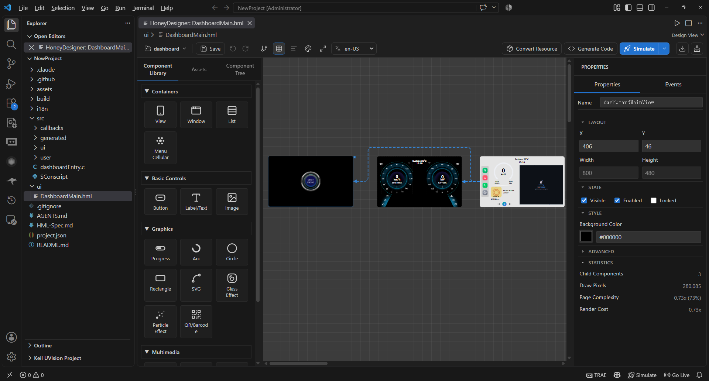
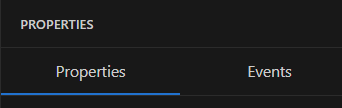
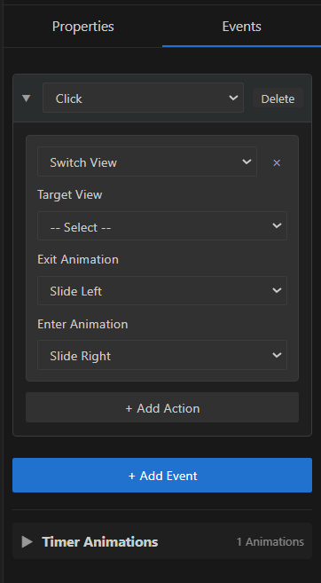

Designer Usage
==============

HoneyDesigner provides a visual canvas, a components and assets panel, a properties panel, and a view navigation graph.

Layout
------

The designer has four main areas:

   Designer interface

1. **Toolbar** (top)

   * Save, undo, and redo.
   * Alignment, distribution, guides, canvas background, and fit-to-content.
   * View relations, preview language, and project configuration selection.
   * Generate code, compile and simulate, debug, stop, UART download, and clean.

2. **Components and Assets Panel** (left)

   * **Component Library**: available components and categories.
   * **Assets**: images, fonts, videos, models, and other resources.
   * **Component Tree**: hierarchy of the current page.

3. **Canvas** (center)

   * Drop, select, move, resize, align, and box-select components.
   * Mouse wheel zooms around the pointer.
   * Smart guides and grid snapping are supported.

4. **Properties Panel** (right)

   * **Properties**: edit the selected component's properties.
   * **Events**: configure event actions.

Toolbar
-------

Common Actions
~~~~~~~~~~~~~~

* **Save**: ``Ctrl+S``.
* **Undo/Redo**: ``Ctrl+Z`` / ``Ctrl+Y`` or ``Ctrl+Shift+Z``.
* **Generate code**: ``Ctrl+G``.
* **Compile and simulate**: starts resource conversion, code generation, compilation, and simulation.
* **Debug simulation**: runs under GDB.
* **Run without code generation**: skips code generation.
* **Stop**: stops the running simulator.
* **UART download**: flashes romfs to the board.
* **Clean**: removes build output.

View Tools
~~~~~~~~~~

* **Show/hide guides**.
* **Align and distribute**: available when two or more components are selected.
* **Canvas background color**.
* **Fit all content**: scales content to the viewport, and the effective zoom range is about 10% to 500%.
* **View relations**: inspect and edit page transitions.
* **Preview language**: switch the project locale used by the canvas, and see :ref:`Localization Preview <designer-localization-preview-en>` for setup.
* **Project configuration**: switch between ``config/*.json`` files.

.. _designer-localization-preview-en:

Localization Preview
~~~~~~~~~~~~~~~~~~~~

The language dropdown in the toolbar only switches the preview language. To display translated text, set up the project first:

1. Open the project menu at the far left of the toolbar and choose **I18n Manager**, then add the locales the project supports. The default locale cannot be removed.
2. Create keys in **I18n Manager**, or edit the existing ``i18n/strings.json`` catalog.
3. In the Properties panel, set ``i18nKey`` on text components to reference a catalog entry. Components without ``i18nKey`` keep using their own ``text``.
4. Use the toolbar language dropdown to switch the preview language. The canvas updates immediately.

The selected preview language is stored as ``activeLocale`` in ``i18n/strings.json`` and saved with the project. Code generation writes the text for the current preview language into the generated C code; generating immediately after switching uses the new locale.

If an entry has no translation for the current locale, the canvas falls back to the default locale, then the component ``text``, then the component name. Use the **Missing Translation** filter in **I18n Manager** to find entries that still need translation.

Project Configurations
~~~~~~~~~~~~~~~~~~~~~~

Projects can keep multiple ``project.json`` variants under ``config/``:

* Switch them from the toolbar project-configuration selector.
* Switching updates the active project configuration and regenerates code.
* Useful for maintaining different resolutions, pixel modes, or target engines.

AI Collaboration Assets
^^^^^^^^^^^^^^^^^^^^^^^

AI collaboration assets can be enabled when creating a project. They include:

* ``.claude/skills/honeygui-designer/``: HML design skill and references.
* ``AGENTS.md``: AI agent entry point.

Set ``"aiAssets": false`` in ``project.json`` to disable them; the extension cleans up distributed assets.

View Navigation Graph
~~~~~~~~~~~~~~~~~~~~~

The view relations button opens a graph of ``switchView`` transitions:

* Nodes represent views.
* Edges represent transitions.
* Edges can be created, edited, or removed.
* Layout is stored in ``.honeygui/nav-layout.json``.

The graph is useful for finding dangling transitions and understanding complex page flows.

Components and Assets Panel
----------------------------

Component Library
~~~~~~~~~~~~~~~~~

Categories
^^^^^^^^^^

**Containers**

.. list-table::
   :header-rows: 1
   :widths: 30 70

   * - Component
     - Purpose
   * - ``hg_view``
     - Page/view container for organizing one screen; cannot be nested inside another ``hg_view``.
   * - ``hg_window``
     - Window container for dialogs, overlays, or independent windows.
   * - ``hg_list``
     - Scrollable list container that manages a set of list items.
   * - ``hg_menu_cellular``
     - Cellular/grid menu container for icon-grid navigation.

**Basic Controls**

.. list-table::
   :header-rows: 1
   :widths: 30 70

   * - Component
     - Purpose
   * - ``hg_button``
     - Button with text, images, click callbacks, and optional toggle state.
   * - ``hg_label``
     - Text label with font, color, gradient, multi-line, and scrolling options.
   * - ``hg_image``
     - Image control with cropping, scaling, and display settings.

**Input Controls (LVGL Only)**

.. list-table::
   :header-rows: 1
   :widths: 30 70

   * - Component
     - Purpose
   * - ``hg_input``
     - Text input field for user input.
   * - ``hg_checkbox``
     - Checkbox for multiple selection.
   * - ``hg_radio``
     - Radio button for mutually exclusive selection within a group.
   * - ``hg_switch``
     - Switch control for toggling between on and off.
   * - ``hg_slider``
     - Slider for continuous value adjustment.
   * - ``hg_progressbar``
     - Progress bar for showing task progress.

**Graphics**

.. list-table::
   :header-rows: 1
   :widths: 30 70

   * - Component
     - Purpose
   * - ``hg_progress``
     - Multi-mode progress component supporting linear, segmented, arc, gauge, and loading modes.
   * - ``hg_arc``
     - Arc control for arcs, ring progress, or gauge elements.
   * - ``hg_circle``
     - Circle control for circles, rings, glow, and shadow effects.
   * - ``hg_rect``
     - Rectangle control for rectangles, rounded corners, borders, glow, and shadows.
   * - ``hg_svg``
     - SVG control for scalable vector graphics.
   * - ``hg_glass``
     - Glass/blur effect control that refracts or blurs the background along a shape path.
   * - ``hg_particle``
     - Particle effect control for effects such as fireworks or snow.
   * - ``hg_qbcode``
     - QR/barcode control that generates a code from its content.

**Multimedia**

.. list-table::
   :header-rows: 1
   :widths: 30 70

   * - Component
     - Purpose
   * - ``hg_video``
     - Video playback control with cropping, scaling, and autoplay.
   * - ``hg_streaming``
     - Streaming control that displays JPEG, RAW, or H.264 frames in real time.
   * - ``hg_gif``
     - GIF animation control.
   * - ``hg_3d``
     - 3D model control for OBJ/GLTF and similar models.
   * - ``hg_lottie``
     - Lottie animation control for JSON-based vector animations.

Engine support:

* **HoneyGUI** does not support input controls (``hg_input``, ``hg_checkbox``, ``hg_radio``, ``hg_switch``, ``hg_slider``, ``hg_progressbar``).
* **LVGL** does not support ``hg_menu_cellular``, ``hg_progress``, ``hg_glass``, ``hg_particle``, ``hg_video``, ``hg_streaming`` and ``hg_3d``.
* The library automatically hides components unsupported by the current ``targetEngine``.

The following controls are not listed directly in the main library:

* ``hg_time_label``: time label that displays the current time in a configured format.
* ``hg_timer_label``: timer label for stopwatch or countdown display.
* ``hg_list_item``: list item container managed by ``hg_list``, representing one row in a list.

Adding Components
^^^^^^^^^^^^^^^^^

1. Drag a control from the component library onto the canvas.
2. Drag images and other assets from the **Assets** panel onto the canvas to create the corresponding image or video controls.

After placement, drag the control to snap it to the edges and centers of the parent container or sibling components. Smart guides appear while snapping. Use the guides button in the toolbar to show or hide the guide lines.

Assets
~~~~~~

The Assets panel manages images, fonts, videos, 3D models, and other project resources. You can:

* Import, rename, and delete assets.
* Configure conversion settings for images, fonts, videos, and other assets.
* Drag assets onto the canvas to create the corresponding image or video controls.

Component Tree
~~~~~~~~~~~~~~

The **Component Tree** area on the left shows the hierarchy of the current page:

.. code-block:: text

   view_home (hg_view)
   ├── lbl_title (hg_label)
   ├── img_logo (hg_image)
   └── btn_next (hg_button)

Operations:

* Click a node to select the component; the canvas highlights it.
* Drag nodes to change parent/child relationships or order.
* Right-click for the context menu.
* Click the arrow to expand or collapse.

.. note::
   ``hg_view`` must not contain another ``hg_view``. Use the ``switchView`` event action for page changes.

Canvas
------

Selection
~~~~~~~~~

* Click a component to select it.
* Hold ``Ctrl`` and click to multi-select.
* Drag on empty canvas space to box-select.
* Press ``Esc`` to clear the selection.

Move and Resize Components
~~~~~~~~~~~~~~~~~~~~~~~~~~

* Drag a component to move it.
* Drag one of the eight handles to resize.
* Arrow keys move 1 pixel; ``Shift`` + arrow keys move 10 pixels.
* Multi-selected components move together.

Zoom and Pan the Canvas
~~~~~~~~~~~~~~~~~~~~~~~

* Mouse wheel zooms around the pointer.
* ``Space`` + drag pans the canvas.
* **Fit all content** scales the design to the viewport.

Align and Distribute
~~~~~~~~~~~~~~~~~~~~

With two or more components selected:

* Align left, right, top, or bottom.
* Center horizontally or vertically.
* Distribute horizontally or vertically.

Shortcuts:

* ``Ctrl+Shift+L/R/T/B/H``: align left/right/top/bottom/horizontal center.
* ``Ctrl+Shift+D``: distribute horizontally.
* ``Ctrl+Alt+D``: distribute vertically.

Context Menu
~~~~~~~~~~~~

Canvas component context menu:

* **Go to Slot Function**: jump to the callback.
* **Copy for AI**: copy component context for an AI agent.
* **Bring to Front / Send to Back**: adjust component stacking.
* **Bring Forward / Send Backward**: move one layer at a time.
* **Lock / Unlock**: lock or unlock the component.
* **Delete**: delete the component.

Use keyboard shortcuts or the component tree for copy, cut, and paste. Rename components in the Properties panel.

Properties Panel
----------------

The Properties panel has two sections: Basic Properties and Events.

Basic Properties
~~~~~~~~~~~~~~~~

   Properties panel

The Properties panel is grouped by category:

* **Basic Info**: name, ID, parent.
* **Layout**: X, Y, width, height.
* **State**: visible, enabled, locked, show overflow.
* **Content**: text, image path, value, placeholder, and related fields.
* **Font**: font file, size, type, render mode.
* **Style**: color, background, border, radius, gradient, glow, shadow.
* **Transform**: rotation, scale, opacity, pivot.
* **Rendering**: blend mode, clipping, high quality.
* **Interaction**: button state, movable, click behavior.
* **Behavior**: timers, animations, special behavior.
* **Advanced**: entry page, resident memory, switch functions.

Specific Properties
^^^^^^^^^^^^^^^^^^^

Specific properties vary by component. The following lists key properties for common components; the full groups are shown in the Properties panel.

**hg_button**

* ``text``: button label
* ``color``: text color
* ``toggleMode``: whether the button has two states
* ``imageOn`` / ``imageOff``: image paths for the on/off states
* ``clickCallback``: click callback function

**hg_label**

* ``text``: text content, with multi-line support
* ``fontSize`` / ``fontFile``: font size and font file
* ``color``: text color
* ``hAlign`` / ``vAlign``: horizontal/vertical alignment (``LEFT``, ``CENTER``, ``RIGHT``; ``TOP``, ``MID``, ``BOTTOM``)
* ``letterSpacing`` / ``lineSpacing``: letter and line spacing
* ``wordWrap`` / ``wordBreak``: wrapping and word breaking
* ``i18nKey``: references a project localization key

**hg_image**

* ``src``: image file path
* ``visible``: whether the image is visible

**hg_arc**

* ``radius``: radius
* ``startAngle`` / ``endAngle``: start and end angles
* ``strokeWidth``: stroke width
* ``color``: color
* ``opacity``: opacity (0-255)
* ``useGradient``: enables a gradient

**hg_circle**

* ``radius``: radius
* ``fillColor`` / ``strokeColor``: fill and stroke colors
* ``strokeWidth``: stroke width
* ``opacity``: opacity (0-255)
* ``useGradient`` / ``gradientType``: gradient switch and type
* ``glowEnabled`` / ``shadowEnabled``: glow and shadow switches

**hg_rect**

* ``borderRadius``: corner radius
* ``fillColor`` / ``strokeColor``: fill and stroke colors
* ``strokeWidth``: stroke width
* ``opacity``: opacity (0-255)
* ``useGradient`` / ``gradientDirection``: gradient switch and direction
* ``glowEnabled`` / ``shadowEnabled``: glow and shadow switches
* ``buttonMode``: button effect (``none``, ``dual-state``, ``opacity``)

Other components (input, switch, slider, list, video, 3D, Lottie, and others) also have their own properties. Glow and shadow are supported only by HoneyGUI.

Events
~~~~~~

   Events panel

The Events panel configures:

* Event type.
* Action type and parameters.
* Key name, message name, and function name.
* Timer control targets.

See :doc:`Event System <event_system>` for details.

Keyboard Shortcuts
------------------

Editing:

* ``Ctrl+S``: save.
* ``Ctrl+Z``: undo.
* ``Ctrl+Y`` or ``Ctrl+Shift+Z``: redo.
* ``Ctrl+C`` / ``Ctrl+X`` / ``Ctrl+V``: copy/cut/paste.
* ``Ctrl+D``: duplicate.
* ``Delete``: delete.

Selection:

* ``Ctrl`` + click: multi-select.
* ``Esc``: clear selection.

Nudge:

* Arrow keys: move 1 pixel.
* ``Shift`` + arrow keys: move 10 pixels.

Other:

* ``Ctrl+G``: generate code.
* ``F5``: preview.
* ``Space`` + drag: pan the canvas.

Best Practices
--------------

* Use meaningful IDs such as ``btn_login`` instead of ``button1``.
* Never nest ``hg_view``.
* Use ``hg_view`` for pages and ``hg_window`` for dialogs.
* Split complex interfaces into multiple HML files.
* Keep component IDs unique across the project.
* Put event logic in protected callback regions or ``src/user``.
* Save and commit HML files regularly.

Next Steps
----------

* Understand :doc:`HML File Format <hml_format>` for manual editing
* Master :doc:`Event System <event_system>` to implement interactions
* Learn :doc:`Code Generation <code_generation>` to understand code structure
