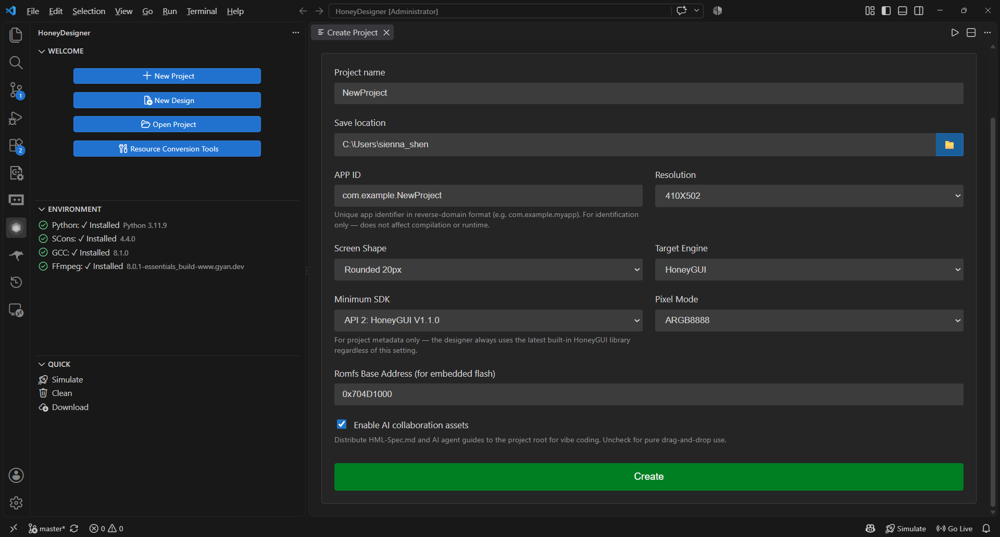
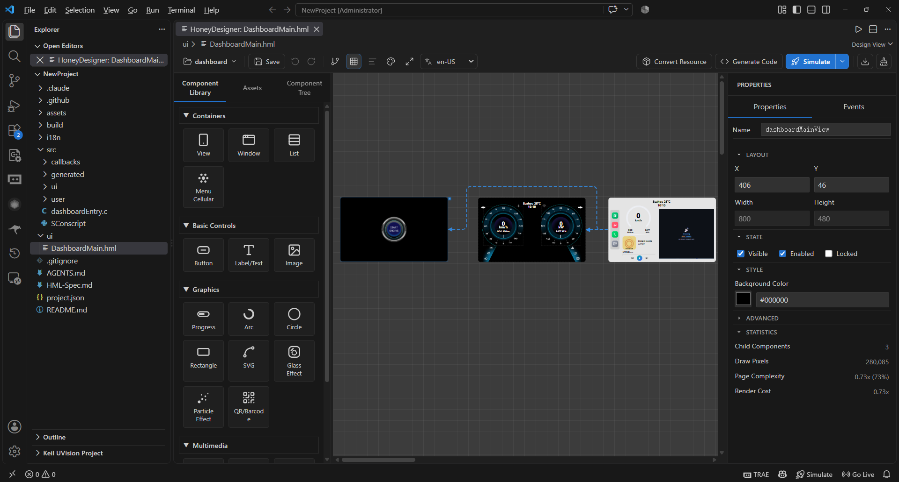
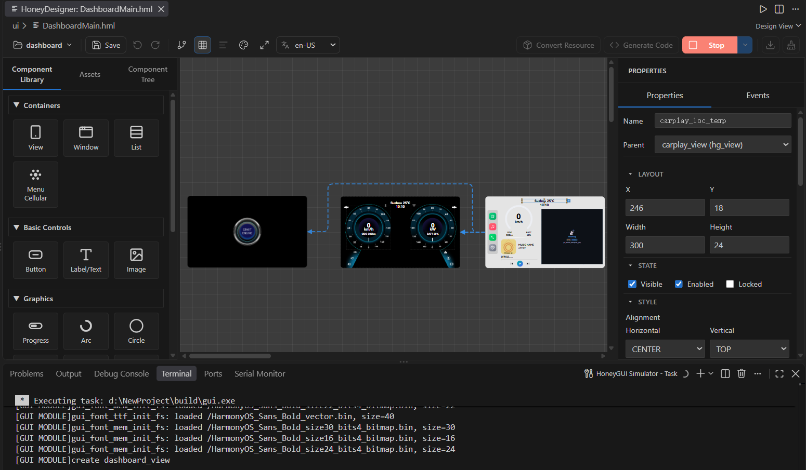

Quick Start
===========

This chapter shows how to install HoneyDesigner, create a project, generate code, and run the first simulation.

Requirements
------------

Required software:

* **VSCode**: 1.80.0 or later.
* **Python**: 3.9.7 or later, used by romfs packaging and build helper scripts.
* **SCons**: 4.4.0, install with ``pip install scons==4.4.0``.
* **GCC/MinGW**: MinGW-w64 8.1.0 or later on Windows; system GCC on Linux/WSL.
* **SDL2**: on Linux/WSL use ``sudo apt-get install libsdl2-dev``.
* **Git**: required when creating a project from a template.

Optional software:

* **FFmpeg**: required for video conversion. Videos are skipped when it is missing.
* **CMake**: required for LVGL simulation.

.. note::
   The current release no longer requires ``kconfiglib`` or a manual ``menuconfig`` step. The build scripts generate a fixed configuration automatically.

Installing the Extension
------------------------

From the Marketplace
~~~~~~~~~~~~~~~~~~~~

1. Open VSCode.
2. Open the Extensions view and search for ``HoneyDesigner``.
3. Click :guilabel:`Install`.

From a VSIX File
~~~~~~~~~~~~~~~~

1. Download the ``.vsix`` file from the :guilabel:`Download Extension` link on the Marketplace page, or use the offline package provided by the team.
2. Open the ``...`` menu in the Extensions view.
3. Select :guilabel:`Install from VSIX...`.
4. Choose the downloaded ``.vsix`` file.

Environment Check
-----------------

1. Click the HoneyDesigner icon in the activity bar.
2. Check Python, SCons, GCC, SDL2, and FFmpeg in the **ENVIRONMENT** view.
3. Click the refresh button, or run ``HoneyDesigner: Refresh Environment Check`` from the Command Palette.
4. Install missing items from the view or use the displayed commands.

Creating Your First Project
----------------------------

1. Click :guilabel:`New Project` in the HoneyDesigner sidebar.
2. Choose **Create empty project** or **Create template project**.
3. Enter the project name, save location, APP ID, and related fields.

Empty projects can configure:

* Resolution
* Screen shape (rectangle, circle, rounded rectangle)
* Target engine (HoneyGUI or LVGL)
* Minimum SDK
* Pixel mode
* Romfs base address
* Whether to enable AI collaboration assets

Available templates:

* Smart Watch
* Car Dashboard
* Chat Bot
* Rotary Knob
* Settings
* E-Badge

.. note::
   Templates are cloned from Git repositories, so the first template project requires network access and ``git``. Empty projects do not require network access.

   Create Project

Project Structure
~~~~~~~~~~~~~~~~~

.. code-block:: text

   my-project/
   ├── project.json              # Project configuration
   ├── ui/                       # HML design files
   │   └── MyProjectMain.hml
   ├── src/                      # Generated C code
   │   ├── MyProjectEntry.c      # Project entry with protected regions
   │   ├── SConscript            # HoneyGUI build script
   │   ├── ui/                   # UI code, overwritten on every generation
   │   ├── callbacks/            # Callback code with protected regions
   │   ├── user/                 # User code, generated once
   │   └── lvgl/                 # LVGL output directory
   ├── assets/                   # Images, fonts, videos, models, and other resources
   ├── i18n/strings.json         # Optional project localization catalog
   ├── config/                   # Optional alternate project.json configurations
   ├── .claude/skills/           # Optional AI collaboration assets
   ├── AGENTS.md                 # Optional AI agent entry point
   └── build/                    # Build and simulation output

Designing Interface
--------------------

Opening the Designer
~~~~~~~~~~~~~~~~~~~~
Double-click an ``.hml`` file in the Explorer. You can also right-click it and choose :guilabel:`Open with HoneyGUI Designer`.

   Visual Designer Interface

Designer Interface Overview
~~~~~~~~~~~~~~~~~~~~~~~~~~~

* **Toolbar**: save, undo, redo, alignment, distribution, code generation, simulation, debug, stop, and download.
* **Left panel**: Tab 1 Component Library, Tab 2 Assets, Tab 3 Component Tree.
* **Canvas**: drop, select, move, resize, align, and box-select components.
* **Right panel**: Properties and Events tabs.

Adding Components
-----------------

1. Select a control in the component library and drag it onto the canvas.
2. Adjust position, size, text, colors, fonts, and related properties in the Properties tab.
3. Configure click, long-press, swipe, key, message, or timer actions in the Events tab.
4. Drag images and other assets from the Assets panel directly onto the canvas.

Basic Operations
~~~~~~~~~~~~~~~~

* **Select**: click a component; hold ``Ctrl`` and click to multi-select.
* **Box select**: drag on empty canvas space.
* **Move**: drag the component; arrow keys move 1 pixel, ``Shift`` + arrow keys move 10 pixels.
* **Resize**: drag one of the eight handles.
* **Delete**: press ``Delete``.
* **Copy/Paste**: ``Ctrl+C`` / ``Ctrl+V``.
* **Undo/Redo**: ``Ctrl+Z`` / ``Ctrl+Y`` or ``Ctrl+Shift+Z``.
* **Generate code**: ``Ctrl+G``.

Generating Code
----------------

Automatic Code Generation
~~~~~~~~~~~~~~~~~~~~~~~~~~

After completing the design, the plugin will automatically generate C code:

1. Click :guilabel:`Generate Code`, or run ``HoneyDesigner: Generate Code``.
2. The extension scans every HML file under the project ``ui/`` directory.
3. It selects the HoneyGUI or LVGL generator from ``targetEngine`` in ``project.json``.

HoneyGUI output:

* ``src/ui/{name}_ui.c/h``: overwritten on every generation.
* ``src/callbacks/{name}_callbacks.c/h``: regenerated while preserving protected regions.
* ``src/user/{name}_user.c/h``: generated once only.
* ``src/{ProjectName}Entry.c``: project entry file.
* ``src/SConscript``: build script.

LVGL output:

* ``src/lvgl/{name}_lvgl_ui.c/h``
* ``src/lvgl/{name}_lvgl_callbacks.c/h``
* ``src/lvgl/lvgl_generated_ui.c/h``
* ``src/lvgl/ui_resource.h`` and ``lv_img_dsc_list.c/h`` in external-bin mode

Protected Regions
~~~~~~~~~~~~~~~~~

Put custom functions inside the protected region of the callback file:

.. code-block:: c

   /* @protected start custom_functions */
   void my_custom_handler(void *obj, gui_event_t *e)
   {
       GUI_UNUSED(obj);
       GUI_UNUSED(e);
   }
   /* @protected end custom_functions */

.. warning::
   * Event callback bodies are regenerated. Do not edit them directly.
   * Implement custom logic in ``custom_functions`` and invoke it with the ``callFunction`` event action.
   * UI code is overwritten on every generation. Do not edit it manually.

Build and Simulation
--------------------

1. Click :guilabel:`Simulate`, or run ``HoneyDesigner: Compile & Simulate``.
2. By default, the extension converts resources, generates code, compiles, and starts the simulator in that order.
3. To skip a stage, open the dropdown to the right of :guilabel:`Simulate` and clear the corresponding item under **Simulation Flow**. The selection is remembered.

The HoneyGUI executable is written to ``build/gui.exe`` on Windows or ``build/gui`` on Linux. LVGL projects use CMake and write the executable to ``lvgl-pc/build/lvgl_pc.exe`` or ``lvgl_pc``.

   Build and simulation

Other simulation commands:

* ``HoneyDesigner: Debug Simulation`` starts a debug session.
* ``HoneyDesigner: Run Simulation Without Code Generation`` skips code generation.
* ``HoneyDesigner: Stop Simulation`` stops the running simulator.

Common Issues
-------------

**Compiler not found**

* Verify that MinGW/GCC is installed and available on ``PATH``.
* Restart the terminal and VSCode.

**SDL2 missing**

* On Linux/WSL run ``sudo apt-get install libsdl2-dev``.

**Videos are not converted**

* Install FFmpeg and add it to ``PATH``.

**Template creation fails**

* Verify that Git is installed and that the Gitee/GitHub repository is reachable.

Next Steps
----------

* Learn :doc:`Designer Usage <designer>` for more design techniques
* Understand :doc:`HML File Format <hml_format>` for advanced customization
* Master :doc:`Event System <event_system>` to implement interactive features
* Explore :doc:`Resource Management <resource_management>` to optimize resource usage
